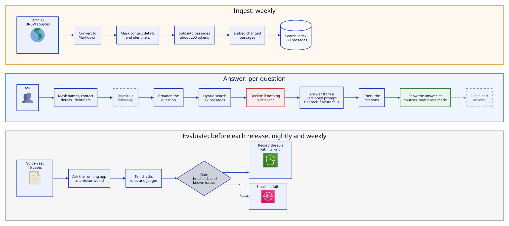

# Policy Desk

Policy Desk answers questions from UNSW staff and students about how AI may be used at UNSW, from the university's published policies and guidance. Every answer cites the passages it came from. When the sources don't cover a question, it says so instead of guessing. Each answer can be traced step by step, and the system is checked against a fixed set of test questions before every release.

It is a deliberately small example of retrieval-augmented generation (RAG) built the way an organisation would run it in production: evaluated, observable, privacy-aware and documented.

**Status, 2 November 2026:** in progress. The service runs on AWS and answers questions with citations. GitHub Actions checks every change, runs an evaluation gate before any change to the answers ships, and deploys; production is evaluated again every night and every week. The site shuts down at the end of November 2026.

| Part | State |
|---|---|
| Source list: 17 public UNSW policies and guidance pages, with licence terms | Done, in [`ingest/sources.yaml`](ingest/sources.yaml) |
| Search index definition for Azure AI Search | Done, in [`search/`](search/) |
| Infrastructure as code for AWS and Azure | Applied: Azure OpenAI and AI Search; the app, the weekly ingest and the scheduled evaluation as Lambda functions, the app behind CloudFront; in [`infra/`](infra/) |
| Design, with diagrams | Done, in [`docs/design.md`](docs/design.md) |
| Design decisions | Done, in [`docs/decisions.md`](docs/decisions.md) |
| Ingest job: fetch, convert, chunk, embed, index | Done: 17 sources, 380 passages indexed, in [`ingest/`](ingest/) |
| Answer service: one page and `POST /ask`, with citations, declines, masking, content safety ratings and Bedrock failover | Deployed on AWS Lambda behind CloudFront, in [`app/`](app/) |
| Evaluation gate: 46 golden questions (40 runnable), rules and thresholds; `make release` ships only what a passing run tested | Done, in [`evals/`](evals/); results in [`docs/evaluation.md`](docs/evaluation.md) |
| Scheduled evaluation against production: a nightly canary, and a weekly full run and failover-model check, each recorded; nightly judge calibration on fixed answers; weekly drift checks on the models, sources and questions | Running on AWS Lambda |
| Telemetry and monitoring: OpenTelemetry traces, a CloudWatch dashboard, alarms by email | Running |
| Public status page (`/status`): alarm states, quality trends, the judges, drift, known issues, use, and UNSW's AI Assurance Framework's seven parts, from aggregates only | Running |
| Privacy impact assessment and policy exemptions | Done (self-assessed), in [`docs/privacy-impact-assessment.md`](docs/privacy-impact-assessment.md) and [`docs/exemptions.md`](docs/exemptions.md) |
| CI/CD on GitHub Actions: checks on every push and pull request; on main, the evaluation gate when answers could change, then an automatic deploy over OIDC | Built, in [`.github/workflows/ci.yml`](.github/workflows/ci.yml) |
| Runbook: what to do for each alarm, and the routine procedures | Done, in [`docs/runbook.md`](docs/runbook.md) |
| Governance documents: a system card, the AI Assurance Framework self-assessment, a data-flow diagram and a user guide | Done, in [`docs/`](docs/) |
| Feedback and admin view | Planned (Phase 3) |

## How it works

The full design, with diagrams of each part and how it relates to UNSW's services and rules, is in [`docs/design.md`](docs/design.md). Dashed steps below are planned. The diagrams are drawn in D2 ([`docs/diagrams/`](docs/diagrams/)).



**Ingest.** A weekly Lambda function fetches each source in [`sources.yaml`](ingest/sources.yaml), at most one page every 10 seconds per site, and converts it to Markdown. It splits the text into passages of about 200 tokens that keep their heading path, embeds them, and pushes them to the search index. Contact details and identifiers are masked before anything is chunked. Unchanged passages are skipped, and sources no longer listed are removed.

**Answer.** For each question:
1. The service masks names, contact details and identifiers, and nothing after this step sees the question as typed. It writes the broader question it's a case of, and searches for both in one hybrid keyword and vector request. At most 4 of the 12 passages it keeps come from any one source.
2. If no passage is similar enough to the question, it declines without calling the model.
3. It answers from the passages only, using a versioned prompt, and rejects any answer without a valid citation.
4. The page shows the answer, its sources and how it was made, including which model wrote it. If Azure OpenAI doesn't respond, Claude Haiku 4.5 on Amazon Bedrock answers instead, and "Try the other model" asks the other one on request. If Azure's content safety filter flags the question, the page shows its rating; if it blocks the question or the answer, the service declines.

Phase 2 adds follow-up questions in a conversation. Phase 3 adds a thumbs-down that puts an answer in a review queue.

**Prove and run.**
- **Before a release:** the evaluation gate asks the running app 40 golden questions and checks each answer, and `make release` refuses to ship answer code that a passing run hasn't tested.
- **In production:** the same gate runs against the live site on AWS: 13 questions nightly, all 40 weekly after the ingest, and 5 on the failover model. Every run is recorded, and a failing one emails. The judges are checked nightly against fixed answers, and a weekly drift check names any new model version, the test questions whose sources changed, and shifts in what visitors ask.
- **Traces and alarms:** each answer can be traced step by step, from the trace ID the page shows. Alarms catch errors, throttling, a broken index and failovers.
- **In public:** a status page shows the alarms, the quality trends, the judges' calibration, drift and known issues, and what's measured for each of the seven parts of UNSW's AI Assurance Framework, from aggregates only.
- **CI/CD:** every push and pull request runs linting and type checks, unit and API tests with fake models, and Terraform validation; pull requests also build and scan the three images. On main, when a file that decides answers changes, the evaluation gate runs the candidate image against the real services, and only if it passes are the images built, scanned, pushed and deployed, followed by a check of `/health` and a canary against production. AWS access is by OIDC, so no cloud keys are stored in GitHub.

## Stack

| Concern | Choice |
|---|---|
| Language and service | Python, FastAPI, one server-rendered page |
| Hosting | AWS, Sydney: Lambda functions from container images, behind CloudFront |
| Answer and embedding models | Azure OpenAI in Australia East. See [data residency](infra/README.md#data-residency) for where each deployment processes data |
| Failover and comparison model | Claude Haiku 4.5 on Amazon Bedrock, AU profile: Sydney or Melbourne |
| Search index | Azure AI Search: Free tier for the demo, Basic for production |
| Flagged-answer store | DynamoDB (Phase 3) |
| Personal-information detection | Microsoft Presidio, with spaCy's small English model |
| Chunking | LangChain text splitters |
| Evaluation | promptfoo as the gate, with a facts judge and Azure AI evaluators as graders; scheduled on Lambda |
| Tracing and metrics | OpenTelemetry spans with GenAI attributes: Jaeger locally, AWS X-Ray with CloudWatch Transaction Search in production; metrics in CloudWatch |
| Identity | Microsoft Entra ID, for the admin view |
| Infrastructure and delivery | Terraform; GitHub Actions with OIDC, so no stored cloud keys |

Reasons and rejected alternatives are in [`docs/decisions.md`](docs/decisions.md).

## Responsible AI and privacy

- **Public sources only.** Every document is public and listed with its licence in the source list.
- **Minimisation.** The service keeps no user accounts and stores no conversations. The page holds the conversation and clears it on refresh or "New conversation".
- **Redaction.** Presidio masks contact details and identifiers in the documents before they are stored, and those and people's names in every question before it reaches a model or a log. The page says what it removed, and still asks people to leave personal details out.
- **Grounding.** Answers must cite retrieved passages. Earlier turns are context, never sources. Out-of-scope questions are declined.
- **Human oversight (Phase 3).** Flagged answers go to a review queue behind Entra sign-in.
- **Location.** The app runs in Sydney, and the index and embeddings in Australia. The Bedrock failover, and the page's "Try the other model", run in Sydney or Melbourne. The Azure chat model uses a global deployment that may process prompts outside Australia, because Azure no longer offers new in-region pay-as-you-go chat models in Australia East. That is acceptable only because the documents are public and questions shouldn't contain personal information; the reasoning is in [`infra/README.md`](infra/README.md#data-residency).
- **Privacy assessment and exemptions.** A self-assessed [privacy impact assessment](docs/privacy-impact-assessment.md) covers questions leaving NSW, and [`docs/exemptions.md`](docs/exemptions.md) records where the service departs from UNSW's information policies, with compensating controls. The page tells people what happens to their question.
- **Assessment.** A [system card](docs/system-card.md) says what the service is for, what it's built from, how well it works and where it falls short. A [self-assessment](docs/ai-assurance-self-assessment.md) against the seven parts of UNSW's AI Assurance Framework quotes UNSW's tests and links the evidence for each, with the status page as live evidence.

## Evaluation

The golden set ([`evals/golden.yaml`](evals/golden.yaml), reviewed) holds 46 cases:
- in-scope questions with known source passages
- out-of-scope questions that must be declined
- questions containing personal details
- prompt-injection attempts
- six short conversations, including a topic switch and an injection planted in the first turn

The gate scores:
- the expected facts each answer states, judged against the documents
- retrieval recall, and whether the expected sources are cited
- faithfulness to the passages
- answer relevance
- correct refusals
- text a prompt injection asked for
- toxicity
- latency
- leaked personal details

Thresholds are set from the first measured baseline, not from tool defaults. Every run is recorded with its kind (release, post-deploy, scheduled, experiment, drill), so trends compare like with like. The runs so far are in [`docs/evaluation.md`](docs/evaluation.md). The same harness compares the two models on quality, cost and latency. It also settles design questions with before-and-after numbers: hybrid against vector-only search, chunk size, and whether a semantic reranker earns its cost.

## Build plan

1. **Walking skeleton.** The app and ingest job run against Azure AI Search and Azure OpenAI. All 17 sources are indexed, answers carry citations, and tests and CI are in place. The phase ends with the first deployment to AWS.
2. **Evidence.** Golden set and evaluation gate, a baseline, masking, conversation memory, traces, Bedrock failover, and experiments with before-and-after numbers.
3. **Operate and govern.** The feedback store and admin view, the nightly evaluation, monitoring and a load test. Then the system card, self-assessment, data-flow diagram, runbook and user guide.

## Running cost

These are estimates, at demo traffic (a handful of people):
- **Lambda and CloudFront:** nothing, inside their free tiers. Nothing runs between requests.
- **Secrets Manager:** about US$2 a month.
- **Model calls:** about US$0.0015 per question.
- **Scheduled evaluation and judge calibration:** about US$2.50 a month in model calls.
- **Azure AI Search Free tier:** nothing.
- **Everything else:** cents.

The total is about A$5–8 a month. Budget alerts email at A$5 (Azure) and US$5 (AWS).

## Repository

```
ragtag/
├─ ingest/         sources.yaml and the weekly job (running on Lambda)
├─ search/         Azure AI Search index definition (done)
├─ app/            FastAPI service and page (running on Lambda)
├─ prompts/        answer and search-rewrite prompts; follow-up prompt planned
├─ docs/           build plan, decisions, design with D2 diagrams, evaluation
│                  results, privacy impact assessment, exemptions, runbook,
│                  system card, AI assurance self-assessment, user guide
├─ evals/          golden set, the evaluation gate, run records, and the
│                  scheduled run on Lambda
├─ scripts/        the release script and checks
├─ tests/          offline unit and API tests
└─ infra/          Terraform for AWS and Azure (applied)
```
